# QR Menu

QR code menu and table ordering for restaurants and cafés, built for India. Guests scan the QR code on their
table, browse the menu in English, Hindi or Marathi, order and follow their food live. The restaurant gets a
live orders board, a kitchen display, staff logins, GST bills with a UPI QR code, sales analytics and guest
feedback, on the website and in the **QR Menu Staff** Android app with push notifications.

<p>
  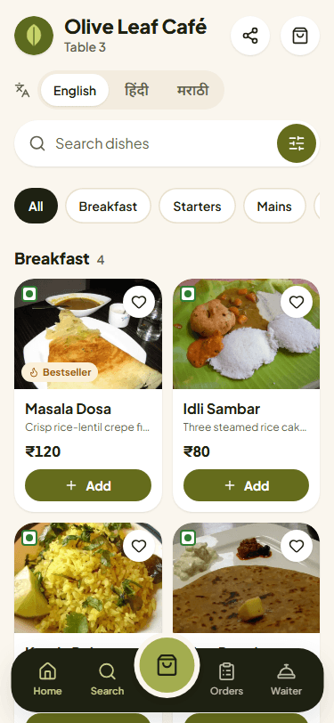
  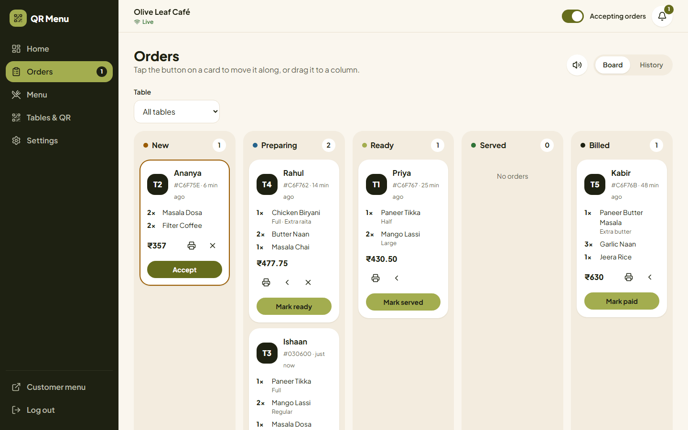
</p>

Restaurant owners: the plain-language guide is [docs/USER_GUIDE.md](docs/USER_GUIDE.md). Planned work is in
[docs/ROADMAP.md](docs/ROADMAP.md). Publishing the app: [docs/PLAY_STORE.md](docs/PLAY_STORE.md).

## Contents

- [Features](#features)
- [Screenshots](#screenshots)
- [Tech stack](#tech-stack)
- [Folder structure](#folder-structure)
- [Setup on Windows](#setup-on-windows)
- [Environment variables](#environment-variables)
- [Demo data and logins](#demo-data-and-logins)
- [Scripts and tests](#scripts-and-tests)
- [Deployment](#deployment)
- [Android staff app](#android-staff-app)
- [How it works](#how-it-works)
- [Resetting the database](#resetting-the-database)

## Features

**Guests (no app, no login)**
- Scan the table's QR code: welcome screen with the restaurant, table number and opening hours
- Menu with categories, search, veg-only and favourites filters, sizes, add-ons, notes and sold-out marks
- English / हिंदी / मराठी switch for dish names and descriptions
- Cart with GST and service charge worked out on the server (prices cannot be tampered with), place order,
  live status (Received, Preparing, Ready, Served), reorder, call a waiter or ask for the bill
- Rate the meal after it is served
- Installable on the home screen; an offline page instead of a browser error

**Owners and staff**
- Live orders board (drag or one tap to move an order along), new-order chime and table requests
- Menu manager: categories, photos with cropping, sizes, add-ons, badges, spice level, Hindi/Marathi names,
  bulk sold-out
- Tables with branded QR codes: PNG per table or an A4 PDF to print
- GST bills: invoice numbers per financial year, 80 mm receipt and A4 invoice PDF, UPI QR with the amount,
  mark paid by cash, UPI or card
- Analytics: sales, orders, top dishes, categories, peak hours, tables and payment mix
- Guest feedback with ratings, tags and comments
- Staff accounts: Owner, Manager, Waiter and Kitchen, each seeing only what they need
- Kitchen display (`/kitchen`) for a tablet or TV, with timers, Start / Bump and Recall
- Signed-in devices in Settings: sign out one browser or phone, or everywhere; account deletion

**QR Menu Staff (Android app)**
- Every dashboard screen of the website, the same login and the same role rules; no guest screens
- Push notifications with their own sounds: new orders (owner, manager, kitchen), waiter calls and bill
  requests (owner, manager, waiter), orders ready to serve (waiter); tapping one opens the order
- Take dish photos with the camera or pick them from the gallery; share QR codes and invoice PDFs to
  WhatsApp or Drive; print receipts through Android's print service
- Kitchen display keeps the screen on; reconnects and catches up after the phone sleeps or the network drops;
  pull to refresh, back button, haptics, offline banner and update prompt

**Quality**
- Every screen is checked at 375, 768 and 1440 px: no sideways scrolling, 44 px tap targets, no WCAG 2.1 AA
  violations (axe-core), no console errors; the whole order flow works with the keyboard
- Lighthouse on the customer menu (mobile): performance 90-92, accessibility, best practices and SEO 100

## Screenshots

All screens at 375 px and 1440 px are in [docs/screenshots](docs/screenshots).

| Guest | Owner | Kitchen and billing |
| --- | --- | --- |
| 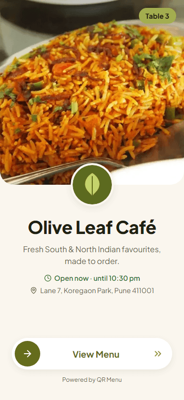 | 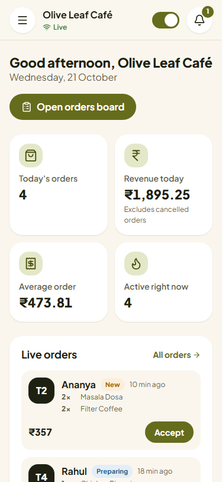 | 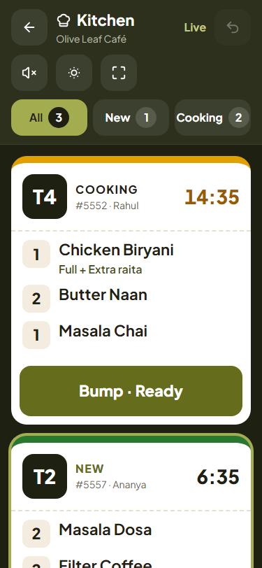 |
| 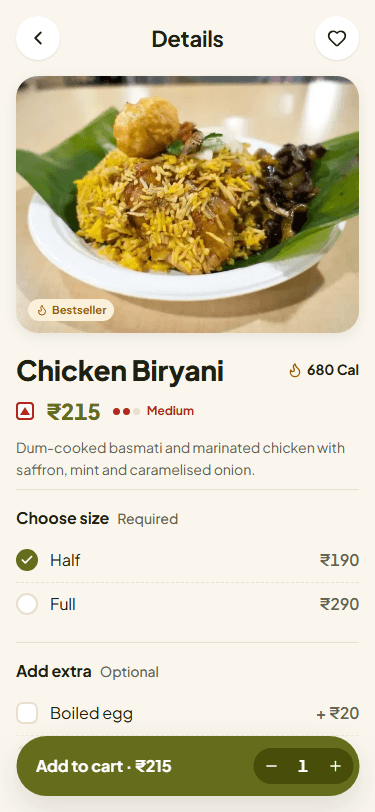 | 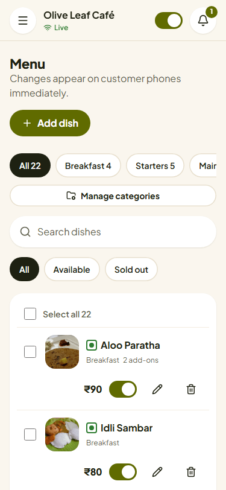 | 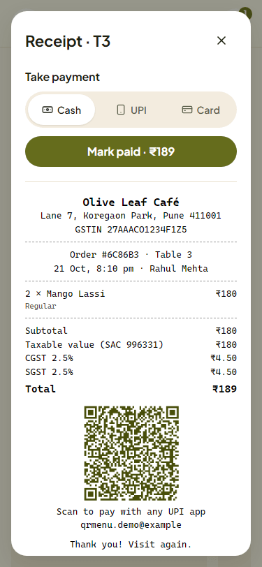 |
| 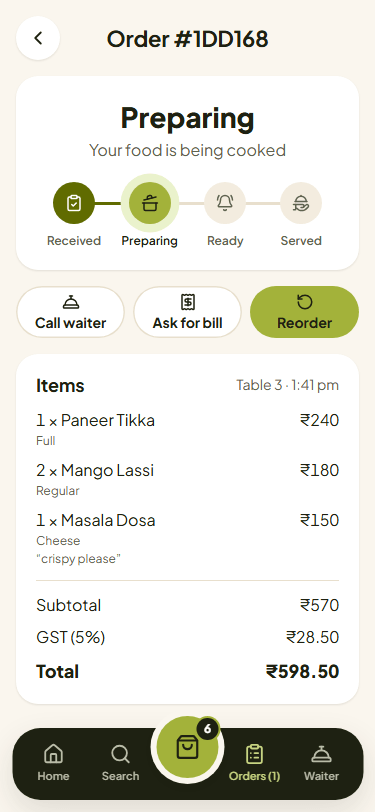 | 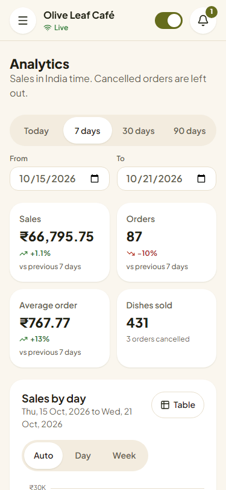 |  |

## Tech stack

| Part | Technology |
| --- | --- |
| Client | React 18, React Router 7, Vite 6, plain CSS with design tokens, lucide icons, Socket.io client, axios; jsPDF and qrcode (loaded only on the screens that need them), react-easy-crop |
| Server | Node.js 22, Express 4, Mongoose 7 (MongoDB), Socket.io 4, zod validation, helmet, express-rate-limit, compression, sharp (images), nodemailer, JWT |
| Image storage | Local disk (development) or Cloudinary (production) |
| Tests | Jest + Supertest + mongodb-memory-server (server), Vitest + React Testing Library (client), Playwright + axe-core (end to end) |
| Staff app | Capacitor 8 (Android, iOS-ready) packaging the same React screens; Keystore-backed secure storage, Firebase Cloud Messaging, camera, share, print |
| Hosting | Client on Vercel or Netlify, API on Render, database on MongoDB Atlas |

## Folder structure

```
QR-Project/
├── client/                    React app (Vite)
│   ├── public/                icons, service worker (sw.js), Netlify _redirects
│   ├── site/assets.js         generated manifests, offline page, robots.txt, SEO tags, menu prefetch
│   ├── site/app.js            staff app build settings (vite --mode app)
│   ├── scripts/               icon, Open Graph image and chime generators; colour contrast check
│   ├── src/
│   │   ├── components/        FoodCard, ImagePicker, CropModal and ui/ (buttons, dialogs, fields...)
│   │   ├── features/          customer/, owner/, kitchen/, auth/, landing/
│   │   ├── lib/               API client, pricing, invoices, sockets, storage, platform layer, helpers
│   │   ├── native/, app/      staff app only: secure storage, push, camera, share, print, app shell
│   │   ├── App.jsx            the website's routes; StaffApp.jsx the app's; staffRoutes.jsx shared
│   │   └── styles/            tokens.css (colours, type, spacing), base.css, components.css
│   ├── vercel.json, netlify.toml
│   └── vite.config.js
├── server/                    Express + Socket.io API
│   ├── src/
│   │   ├── config/            environment validation, MongoDB connection
│   │   ├── controllers/, routes/, validators/, middleware/
│   │   ├── models/            User (restaurant), MenuItem, Order, Staff, Upload, ServiceRequest...
│   │   ├── services/          pricing, invoices, analytics, images, storage (local, Cloudinary), mailer,
│   │   │                      sessions, push (FCM)
│   │   └── sockets/           live orders, menus and order tracking
│   ├── scripts/               seed, upload cleanup, base64 image migration, guarded database reset
│   └── tests/                 Jest test suites
├── mobile/                    QR Menu Staff: Capacitor project (android/), app.config.json, build scripts
├── e2e/                       Playwright tests (flows, responsive and accessibility audit, keyboard; app/)
├── docs/                      USER_GUIDE.md, ROADMAP.md, PLAY_STORE.md, screenshots/
├── design-reference/          UI reference image
├── render.yaml                Render Blueprint for the API
├── playwright.config.js       end-to-end tests against the dev servers
├── playwright.prod.config.js  the same tests against a production build
├── playwright.app.config.js   the staff app build at phone and tablet sizes
└── package.json               scripts that drive both apps
```

## Setup on Windows

You need about 15 minutes and these programs:

1. **Git**: <https://git-scm.com/download/win> (keep the default options).
2. **Node.js 22 LTS** (22.12 or newer) with npm 10 or newer: the "LTS" installer from <https://nodejs.org>,
   or with nvm-windows run `nvm install 22` then `nvm use 22`. Check with `node -v` and `npm -v`.
   Newer Node versions (24) also work.
3. **MongoDB**, one of:
   - **Docker Desktop** (<https://www.docker.com/products/docker-desktop/>). Start it, then run once:
     ```powershell
     docker run -d --name qr-mongo -p 27017:27017 -v qr-mongo-data:/data/db mongo:7
     ```
     After a restart of the PC, start Docker Desktop and run `docker start qr-mongo`.
   - **MongoDB Community Server** (<https://www.mongodb.com/try/download/community>), installed as a
     Windows service.
   - A free **MongoDB Atlas** cluster (see [Deployment](#1-database-mongodb-atlas)); put its connection string
     in `MONGODB_URI`.

Then, in PowerShell:

```powershell
git clone https://github.com/omgawande1523/QR-Project.git
cd QR-Project
npm run install:all
Copy-Item server\.env.example server\.env
Copy-Item client\.env.example client\.env
```

Open `server\.env` in a text editor and set `JWT_SECRET` to the output of:

```powershell
node -e "console.log(require('crypto').randomBytes(32).toString('hex'))"
```

Load the demo restaurant and start both apps:

```powershell
npm run seed
npm run dev
```

Open <http://localhost:3000>. The API runs on <http://localhost:5000>. If port 3000 is taken, Vite uses 3001,
which the API also allows in development.

To try the guest side on your phone, put the phone on the same Wi-Fi, set `VITE_API_URL` in `client\.env` to
your PC's address (for example `http://192.168.1.20:5000`, see `ipconfig`), add `http://192.168.1.20:3000` to
`CORS_ORIGINS` in `server\.env`, restart `npm run dev` and open `http://192.168.1.20:3000` on the phone.

Never commit `server\.env` or `client\.env`; `.gitignore` already excludes them.

## Environment variables

### server/.env

| Variable | Required | What it does |
| --- | --- | --- |
| `NODE_ENV` | yes | `development` locally, `production` on the server. Production turns off the localhost CORS origins and turns on JSON request logs. |
| `PORT` | no | Port the API listens on. Default 5000; Render sets it for you. |
| `MONGODB_URI` | yes | MongoDB connection string, e.g. `mongodb://localhost:27017/qr-menu` or an Atlas `mongodb+srv://...` string. |
| `JWT_SECRET` | yes | Secret that signs login tokens, at least 32 characters. The server refuses to start without it. Changing it logs everyone out. |
| `FRONTEND_URL` | yes in production | Address of the client site (no trailing slash), e.g. `https://menu.example.com`. Allowed by CORS and used in password-reset links. |
| `CORS_ORIGINS` | no | Extra allowed client addresses, comma separated (a `www.` variant, a Vercel preview URL, a phone on your Wi-Fi). |
| `TRUST_PROXY` | yes in production | Number of proxies in front of the API: `0` locally, `1` on Render, Railway or Heroku. Without it every guest shares one IP for the rate limits. |
| `PUBLIC_URL` | yes in production with local storage | Public address of the API, used in links to images stored on local disk. Default `http://localhost:PORT`. Not used with Cloudinary. |
| `STORAGE_DRIVER` | no | Where uploaded images go: `local` (default, `server/uploads`) or `cloudinary`. Use `cloudinary` on Render. |
| `UPLOAD_DIR` | no | Folder for `local` storage. Default `server/uploads`. Point it at a persistent disk if you use one. |
| `CLOUDINARY_URL` | with `cloudinary` | `cloudinary://<api_key>:<api_secret>@<cloud_name>`, the "API environment variable" in the Cloudinary console. |
| `CLOUDINARY_FOLDER` | no | Cloudinary folder for this site's images. Default `qr-menu`. Use a different one per environment (e.g. `qr-menu-staging`). |
| `UPLOAD_CLEANUP` | no | Set to `off` to stop the automatic removal of images that were uploaded but never used. On by default. |
| `EMAIL_USER`, `EMAIL_PASS` | no | Gmail address and app password (Google account > Security > App passwords) for password-reset codes and landing-page enquiries. Leave blank to turn email off; password reset is then disabled. |
| `FIREBASE_SERVICE_ACCOUNT` | for app push notifications | The Firebase service-account key (Project settings > Service accounts > Generate new private key): the JSON on one line, or the path to the `.json` file kept outside the repository. Empty: no push notifications. |
| `APP_MIN_VERSION` | no | Staff app versions below this (e.g. `1.2.0`) must update before they can be used. Default `1.0.0`. |
| `APP_LATEST_VERSION` | no | Staff app versions below this see a dismissible "Update available". Defaults to `APP_MIN_VERSION`. |
| `APP_UPDATE_URL` | no | Where the app's Update button goes. Default: the Play Store page of `com.qrmenu.staff`. |

### client/.env

Only `VITE_*` variables reach the browser, so never put secrets here. They are read **when the client is
built**: after changing one on Vercel or Netlify, redeploy.

| Variable | What it does |
| --- | --- |
| `VITE_API_URL` | Address of the API, no trailing slash. Default `http://localhost:5000`; in production e.g. `https://api.example.com`. |
| `VITE_SOCKET_URL` | Socket.io address if it differs from the API (normally leave empty). |
| `VITE_SITE_URL` | Public address of the client site, e.g. `https://menu.example.com`. Needed in production for link previews (Open Graph image), the canonical link and `sitemap.xml`. Empty in development. |
| `VITE_CONTACT_EMAIL` | Support address shown on `/privacy` and `/delete-account` (must match the Play Store listing). Empty: those pages point to the contact form. |

The staff app has its own file, `client/.env.app.local` (see `client/.env.app.example`): `VITE_API_URL`, `VITE_SITE_URL` and
`VITE_CONTACT_EMAIL` for the app build. It does not read `client/.env`. See [Android staff app](#android-staff-app).

## Demo data and logins

```powershell
npm run seed
```

Creates **Olive Leaf Café**: 22 dishes with photos (and Hindi/Marathi names), 5 tables, live orders, a waiter
call and eight weeks of order history for the analytics page. It prints the guest menu link.

| Login | Password | Sees |
| --- | --- | --- |
| demo@qrmenu.test | Demo@1234 | Owner: everything |
| manager@qrmenu.test | Demo@1234 | Manager: everything except staff |
| waiter@qrmenu.test | Demo@1234 | Waiter: orders, bills and table requests |
| kitchen@qrmenu.test | Demo@1234 | Kitchen: the kitchen display |

Running the seed again replaces only the demo restaurant's own data. The "Try live demo" button on the landing
page opens the demo café at table 1. Photo credits: `server/scripts/seed-assets/CREDITS.md`.

## Scripts and tests

Run from the repository root:

| Script | What it does |
| --- | --- |
| `npm run install:all` | Installs root, server, client and mobile dependencies |
| `npm run dev` | API (nodemon) and client (Vite) together |
| `npm run seed` | Loads the demo restaurant |
| `npm test` | Server tests (Jest, 283 tests on an in-memory MongoDB) and client tests (Vitest) |
| `npm run lint` | ESLint on the client |
| `npm run build` | Production build of the client into `client/build` |
| `npm start` | Starts the API (as Render does) |
| `npm run e2e` | Playwright end-to-end tests against the dev servers (starts them if needed; run `npm run seed` first) |
| `npm run e2e:prod` | Builds the client, starts the API with `NODE_ENV=production` and the built client as static files, then runs the same tests. Ports 3000 and 5000 must be free. |
| `npm run e2e:app` | The staff app build in a browser at phone and tablet sizes: every role's screens, an order from the website menu to the app and back (ports 3000, 3001 and 5000) |
| `npm run app:doctor` | Checks JDK 21, the Android SDK, plugin versions, Firebase and signing files |
| `npm run app:build` | Builds the staff screens into `client/dist-app` and checks no guest code is in them |
| `npm run app:sync` | `app:build`, then copies the screens and plugins into the Android project |
| `npm run app:apk` | `app:sync`, then a debug APK for testing: `mobile/dist/qr-menu-staff-<version>-debug.apk` |
| `npm run app:aab` | `app:sync`, then the signed release bundle for the Play Store: `mobile/dist/qr-menu-staff-<version>.aab` |
| `npm run app:run` | `app:sync`, then installs and starts the app on a connected phone or running emulator |
| `npm run app:open` | Opens the Android project in Android Studio |

Other tools:

| Command | What it does |
| --- | --- |
| `npm --prefix client run check:contrast` | Checks every colour pair in the design tokens against WCAG AA |
| `npm --prefix server run cleanup:uploads -- --dry-run` | Lists images that would be removed as unused (drop `--dry-run` to remove them) |
| `node server/scripts/migrate-base64-images.js` | One-off upgrade for databases from the first version of the app, which stored images inside the database. Dry run by default; `--apply` to convert. |
| `node scripts/make-icons.mjs`, `node scripts/make-og-image.mjs` | Regenerate app icons and the link-preview image (run inside `client/`) |

What the end-to-end suite covers (57 tests): the full order flow from scan to served, price tampering, the
owner board, menu and sold-out, QR downloads, billing, analytics, feedback, languages, images (upload, crop,
paste, links), staff roles, the kitchen display, PWA install and offline, SEO tags; every screen at 375, 768
and 1440 px (horizontal scroll, 44 px tap targets, bottom-nav overlap, console errors and React warnings, axe
WCAG 2.1 AA, a very long English and Hindi dish name); a keyboard-only order with visible focus, dialog focus
traps and screen-reader announcements.

## Deployment

The usual setup: **MongoDB Atlas** (database), **Render** (API), **Cloudinary** (images), **Vercel or
Netlify** (client).

```
 guest phone / owner laptop
          │
          ▼
 https://menu.example.com  ── Vercel / Netlify: client/build (static files)
          │  API calls and live updates
          ▼
 https://api.example.com   ── Render: server/ (Express + Socket.io)
          │                         │
          ▼                         ▼
   MongoDB Atlas              Cloudinary (photos)
```

### 1. Database: MongoDB Atlas

1. Create a free account at <https://www.mongodb.com/cloud/atlas> and a cluster (M0 is enough to start;
   choose the Mumbai region).
2. Database Access: add a user with a long generated password.
3. Network Access: allow `0.0.0.0/0` (Render's outgoing addresses change), or Render's static outbound IPs on
   paid plans.
4. Connect > Drivers: copy the `mongodb+srv://...` string, put the password in and add the database name
   before the `?`, e.g. `.../qr-menu?retryWrites=true&w=majority`. That is `MONGODB_URI`.

To load the demo restaurant into Atlas, run `npm run seed` locally with `MONGODB_URI` set to the Atlas string.
Never run `server/scripts/reset-db.js` against Atlas (it refuses non-local databases).

### 2. Images: Cloudinary (recommended)

Render's disk is wiped on every deploy and restart, so images saved to local disk disappear. Two options:

| | Cloudinary (recommended) | Render persistent disk |
| --- | --- | --- |
| Cost | Free plan covers a small restaurant group (25 monthly credits) | Paid instance plus about $0.25 per GB per month |
| Speed | Served from a CDN, resized per screen size automatically | Every image goes through the API server |
| Scaling | Any number of API instances | One instance only, and deploys have downtime while the disk moves |
| Setup | One environment variable | Add a disk, set `UPLOAD_DIR` and `PUBLIC_URL` |

**Cloudinary**: create an account at <https://cloudinary.com>, open Settings > API Keys, copy the
"API environment variable" (`cloudinary://...`) into `CLOUDINARY_URL` and set `STORAGE_DRIVER=cloudinary`.
Images then live in the `CLOUDINARY_FOLDER` folder (default `qr-menu`).

**Persistent disk instead**: on a paid Render instance add a disk (e.g. mount path `/var/data`, 1 GB), set
`STORAGE_DRIVER=local`, `UPLOAD_DIR=/var/data/uploads` and `PUBLIC_URL` to the API address.

Switching drivers does not move existing images; set the driver before owners upload their own photos.

### 3. API: Render

**With the Blueprint** (easiest): Render dashboard > New > Blueprint > connect this GitHub repository.
`render.yaml` creates the `qr-menu-api` web service (Starter plan, Singapore region, Node 22, health check
`/health`, a generated `JWT_SECRET`, Cloudinary storage). Render then asks for:

| Variable | Value |
| --- | --- |
| `MONGODB_URI` | the Atlas string from step 1 |
| `FRONTEND_URL` | the client address, e.g. `https://menu.example.com` (use the Vercel/Netlify address until you have a domain) |
| `CORS_ORIGINS` | other client addresses, comma separated, e.g. `https://www.menu.example.com,https://qr-menu.vercel.app`; can be empty |
| `PUBLIC_URL` | the API address, e.g. `https://qr-menu-api.onrender.com` |
| `CLOUDINARY_URL` | from step 2 |
| `EMAIL_USER`, `EMAIL_PASS` | Gmail address and app password, or leave empty |
| `FIREBASE_SERVICE_ACCOUNT` | the Firebase service-account JSON for staff app notifications, or leave empty |

**By hand**: New > Web Service > this repository, Root Directory `server`, Build Command `npm ci`, Start
Command `node server.js`, Health Check Path `/health`, and the environment variables above plus
`NODE_ENV=production`, `TRUST_PROXY=1`, `NODE_VERSION=22`, `STORAGE_DRIVER=cloudinary` and a `JWT_SECRET`
of 64 random characters.

Notes:
- Choose Starter or above. Free instances sleep after 15 minutes without traffic: the first guest of the day
  waits about a minute and live order updates drop.
- `/health` returns 200 when the API and database are up and 503 when MongoDB is unreachable, so Render only
  sends traffic to a working instance.
- On deploys Render sends SIGTERM; the API stops taking new connections, finishes open requests, closes
  sockets and the database, then exits (10 s limit).
- Logs (Render > Logs) are one JSON line per event and per request: method, path, status, time and request id.
  Query strings, request bodies, headers, IP addresses, passwords and tokens are never logged.

### 4. Client: Vercel or Netlify

**Vercel**: Add New > Project > import the repository. Root Directory `client` (Vercel then reads
`client/vercel.json`: Vite, `npm run build`, output `build`, page routes go to `index.html`, long caching for
`/assets`). Node.js version 22 (Project Settings > General). Environment variables:

| Variable | Value |
| --- | --- |
| `VITE_API_URL` | the API address, e.g. `https://qr-menu-api.onrender.com` |
| `VITE_SITE_URL` | the client address, e.g. `https://qr-menu.vercel.app` |

**Netlify**: Add new site > Import from Git > the repository, Base directory `client` (Netlify then reads
`client/netlify.toml`: `npm run build`, publish `build`, Node 22, caching headers; `public/_redirects` sends
page routes to `index.html`). Add the same two `VITE_*` variables under Site configuration > Environment
variables.

After the first client deploy, put its address in `FRONTEND_URL` (or `CORS_ORIGINS`) on Render. If the browser
console shows a CORS error, the client address is missing from those two variables.

### 5. Custom domain

1. Client: add `menu.example.com` in Vercel (Project > Settings > Domains) or Netlify (Domain management) and
   create the DNS record they show (a CNAME to `cname.vercel-dns.com` or your Netlify site).
2. API (optional but tidy): add `api.example.com` in Render (Settings > Custom Domains) and create its CNAME.
3. Update the addresses everywhere, then redeploy both:
   - Render: `FRONTEND_URL=https://menu.example.com`, `PUBLIC_URL=https://api.example.com`, and keep the old
     client address in `CORS_ORIGINS` until nobody uses it
   - Vercel/Netlify: `VITE_API_URL=https://api.example.com`, `VITE_SITE_URL=https://menu.example.com`
4. **Print table QR codes only after the domain is final.** A QR code contains the address of the site the
   owner downloaded it from; codes printed from a temporary address stop working when that address goes away.

HTTPS certificates are issued automatically by all three hosts.

### 6. Check the deployment

- `https://api.example.com/health` shows `"status":"healthy"`
- Register a restaurant on the live site, add a dish, open a table QR code on a phone, place an order and see
  it arrive on the dashboard
- Upload a dish photo, redeploy the API, and check the photo is still there (it is in Cloudinary)
- Locally, `npm run e2e:prod` runs the whole end-to-end suite against a production build before you deploy

## Android staff app

**QR Menu Staff** (`com.qrmenu.staff`) is the restaurant side of QR Menu as an Android app: the same React
dashboard screens packaged with [Capacitor](https://capacitorjs.com), the same accounts and passwords as the
website (sign in, sign up, reset), and exactly the same role rules. Guests never use it: the landing page,
customer menu, cart and order tracking are not in the app, and the build fails if any of their code gets in.

<p>
  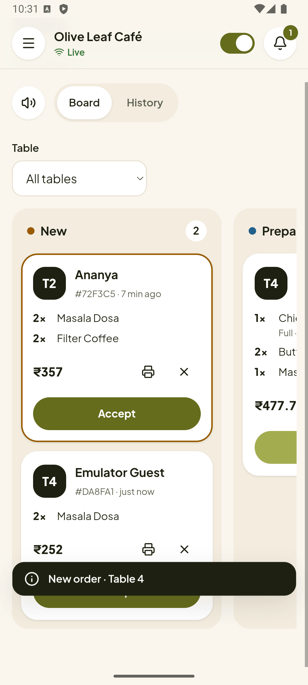
  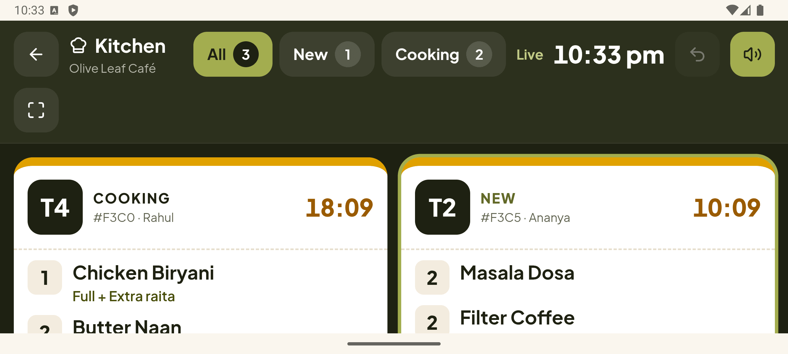
</p>

### What the app adds

| | |
| --- | --- |
| Push notifications | New order → owner, manager, kitchen. Waiter call, water, cutlery or bill → owner, manager, waiter. Order ready → waiter. Delivered with the app closed or the phone locked, each type on its own high-priority Android channel with its own sound; tapping opens the order (the kitchen opens its display). Each phone switches types on and off in Settings. |
| Camera | Take photo / Choose from gallery in every image field, then the usual crop screen |
| Share and print | Table QR codes and invoice PDFs open the share sheet (WhatsApp, Drive, Gmail...); Print uses Android's print service |
| Kitchen display | Keeps the screen on while open; full screen hides the status bar; works in landscape on tablets |
| Reliable live updates | Reconnects and refetches open orders when the app returns to the foreground or the network comes back; offline banner |
| Phone basics | Back button closes dialogs and the menu first, then goes back, then leaves the app from the start screen; pull to refresh; haptics on status changes; status bar and splash in the brand colours; adaptive icon with a themed-icon layer |
| Accounts | Login kept in Keystore-backed secure storage (not localStorage), renewed while in use (30 days); Settings shows signed-in devices; update prompt when the server asks for a newer version |

### Requirements

- **JDK 21**: [Eclipse Temurin 21](https://adoptium.net) or the one inside Android Studio. `JAVA_HOME` may stay on an
  older JDK: the scripts look for 21 in the usual folders (or set `QRMENU_JAVA_HOME`).
- **Android SDK** with Platform 36 and Build-Tools 36: [Android Studio](https://developer.android.com/studio) >
  SDK Manager, or the command-line tools. Set `ANDROID_HOME` (usually `%LOCALAPPDATA%\Android\Sdk`).
- Optional: the Android Emulator with an Android 36 Google Play system image.
- `npm run install:all` installs `mobile/` too. `npm run app:doctor` checks everything.

### Try it on the emulator

1. Start the website and API as usual: `npm run seed`, then `npm run dev`.
2. Start an emulator (Android Studio > Device Manager, or
   `%LOCALAPPDATA%\Android\Sdk\emulator\emulator -avd <name>`).
3. `npm run app:run` builds, installs and opens the app. It talks to `http://10.0.2.2:5000`, which is the PC as
   seen from the emulator, and needs no settings.
4. Sign in with a demo login, e.g. `demo@qrmenu.test` / `Demo@1234`.

Dish photos you upload get their address from the server's `PUBLIC_URL`, which defaults to
`http://localhost:5000`: on the emulator or a phone that is the device itself, so new photos would not show. Set
`PUBLIC_URL=http://<PC address>:5000` in `server/.env` (the PC's IPv4 address from `ipconfig`; the website on
the PC and the emulator reach it too) and restart the API. Not needed with Cloudinary or in production.

### On your phone (same Wi-Fi as the PC)

1. Find the PC's address with `ipconfig` (IPv4 Address, e.g. `192.168.1.20`).
2. Create `client\.env.app.local`:
   ```
   VITE_API_URL=http://192.168.1.20:5000
   VITE_SITE_URL=http://192.168.1.20:3000
   ```
3. `npm run app:apk`, then copy `mobile\dist\qr-menu-staff-<version>-debug.apk` to the phone (USB, Drive, or
   WhatsApp to yourself) and open it; allow installing from that source when Android asks. Or connect the phone
   with USB debugging on and run `npm run app:run`.
4. Set `PUBLIC_URL=http://192.168.1.20:5000` in `server/.env` and restart the API, so photos you upload load
   on the phone (see above).
5. If the phone cannot reach the PC, allow Node.js through Windows Defender Firewall for private networks.

Debug builds allow plain `http` to such a local address; release builds only talk `https`.

### Push notifications (Firebase)

1. In the [Firebase console](https://console.firebase.google.com) create a project and add an Android app with
   the package name `com.qrmenu.staff`.
2. Download `google-services.json` into `mobile/android/app/` (never committed). The next `app:apk` / `app:aab`
   turns push on in the app.
3. Project settings > Service accounts > Generate new private key. Put the file outside the repository and set
   `FIREBASE_SERVICE_ACCOUNT` on the server to its path, or to the JSON itself on one line (on Render: the JSON).

Without these files the app works the same, just without notifications.

### Release

Versions live in `mobile/app.config.json` (`versionName`, and `versionCode`, which must go up for every
upload). `npm run app:aab` writes the signed bundle to `mobile/dist/`. The upload key is
`D:\keys\qrmenu-staff.jks` with its passwords in `D:\keys\qrmenu-staff.properties` (and in
`mobile/android/keystore.properties`, which git ignores); back both up. Listing text, Data safety answers and
the Play Console steps: [docs/PLAY_STORE.md](docs/PLAY_STORE.md).

### How it works

- `vite build --mode app` builds `client/dist-app` from `src/main.app.jsx` and `StaffApp.jsx`, which share the
  staff routes with the website through `src/staffRoutes.jsx`. A build plugin fails if a customer or landing
  module is bundled, and `client/scripts/check-bundles.mjs` checks both outputs: no guest screens in the app, no
  Capacitor code on the website.
- `src/lib/platform.js` is the only switch: `IS_APP` is a build-time constant (the website build drops every
  app branch), `isNative()` is true inside the installed app. App-only code sits in `src/native/` (secure
  storage, push, camera, share, print, start-up) and `src/app/` (back button, notifications, offline banner,
  update prompt). The app build opened in a normal browser falls back to web behaviour, which is how
  `npm run e2e:app` tests it at phone and tablet sizes.
- Logins are server-side sessions (`server/src/models/Session.js`): each token carries its session id, a phone's
  push token belongs to its session, and signing out, changing or resetting a password, a staff role change or
  deactivation ends the sessions concerned, the app's included, and drops their live connections.
- Push messages are sent by the server through the FCM HTTP v1 API (`server/src/services/push`) right after the
  database write, like the socket events.
- The API allows the app's origins (`https://localhost` on Android, `capacitor://localhost` on iOS) for CORS and
  Socket.io, exact matches only. Nothing needs adding on Render.
- `GET /api/app-version` tells the app the minimum and latest versions (`APP_MIN_VERSION`,
  `APP_LATEST_VERSION`).
- iOS: the code is iOS-ready (no Android-only assumptions in the web code); adding it needs a Mac with Xcode:
  `npx cap add ios` in `mobile/`.

## How it works

### Design system

Colours, type, radii, shadows and spacing are tokens in `client/src/styles/tokens.css` (olive scale around
`--olive-500`, cream background, ink text). Filled buttons use `--olive-700` with white text (WCAG AA); light
olive only sits under dark text. Every control is at least 44 px (`--tap`) and the focus ring is a 3 px olive
outline (light olive on dark surfaces). `npm --prefix client run check:contrast` checks every colour pair.
Reusable components live in `client/src/components/ui`.

### Performance

Each screen is its own chunk, so a scanned QR code downloads only what the customer menu needs: React and the
router (`vendor`), shared UI (`ui`), axios and the menu screens, about 110 KB of JavaScript gzipped. PDF, QR,
cropping and chart code load only on the screens that use them, and socket.io loads after the menu is on
screen. For `/menu/...` addresses, `index.html` starts the restaurant and menu requests while the app code
downloads (`client/site/assets.js`). Dish photos come in several widths (`?w=320` from the API, or a Cloudinary
transformation) with `srcset`, and the first cards load eagerly. API responses are gzipped. The Hindi/Marathi
font downloads only when Devanagari dish names are shown.

### Billing

"Bill" on a served order assigns a GST invoice number, consecutive per restaurant and Indian financial year
(`2026-27/000001`, within GST's 16-character limit), and opens the bill: an 80 mm printable receipt and an A4
invoice PDF with GSTIN, place of supply (from the GSTIN state code), SAC 996331, taxable value, CGST/SGST split
in whole paise and the amount in words. Without a GSTIN the document is titled "Bill" instead of "Tax Invoice".
If the restaurant sets a UPI ID in Settings, unpaid bills carry a UPI QR code with the amount filled in.
"Mark paid" records cash, UPI or card (with an optional reference) and closes the order. Payment taken before
the food is served keeps the order on the kitchen display. Owners, managers and waiters can bill; the kitchen
cannot.

### Analytics

`/dashboard/analytics` (owner and manager) shows sales for today, 7, 30 or 90 days or a custom range, in India
time and excluding cancelled orders: sales, orders, average order and dishes sold against the previous period;
sales by day (or by week for ranges over a month); top dishes; sales by category; a weekday x hour heatmap of
orders; orders, sales and QR scans per table; and the payment mix. Charts are plain SVG/HTML with hover and
keyboard tooltips and a table view for each.

### Feedback

Once an order is served, the guest's order page asks "How was your meal?": 1 to 5 stars, quick tags and an
optional comment. One rating per order, proved by the order's tracking token. `/dashboard/feedback` shows the
average, the share of happy guests, the rating distribution, the most-mentioned tags and the latest comments.

### Menu languages

Each dish can have an optional Hindi and Marathi name and description. When any dish has a translation, the
customer menu shows an English / हिंदी / मराठी switch; the guest's choice is remembered, untranslated text falls
back to English, and search matches either language. Orders, the kitchen display and bills always use the
English names. The demo menu's translations are machine-assisted; have a native speaker check them for a real
restaurant.

### Installable app (PWA)

Both the dashboard and the customer menu can be installed from the browser. The dashboard manifest opens
`/dashboard`; on a menu page the manifest is swapped for one that opens `/menu/`, which returns the guest to the
restaurant they last visited. `public/sw.js` shows an offline page when there is no connection and caches only
the offline page, icons and content-hashed build files: menus, orders and the API always come from the network.
`public/service-worker.js` only removes a worker registered by an earlier version of the app.

### SEO and link previews

The landing page gets its title, description, Open Graph and Twitter tags at build time, with
`client/public/og-image.jpg` (1200 x 630) as the preview image. Set `VITE_SITE_URL` in production: link previews
need an absolute image URL, and it also enables the canonical link and `sitemap.xml`. `robots.txt` keeps
`/dashboard` and `/kitchen` out of search results. Every screen sets its own tab title.

### Images

Every image field (dish photo, logo, banner, QR logo) uses one picker: upload or drag and drop, paste with
Ctrl+V, or paste an image link. Each image is cropped in the browser and the **server** applies the crop to the
stored full-size original with sharp, so "Edit crop" works later without uploading again.

| Field | Crop ratio | Stored size |
| --- | --- | --- |
| Dish photo | 4:3 | 1200 x 900 WebP |
| Restaurant logo | 1:1, shown round | 512 x 512 |
| Banner | 1:1 | 1200 x 1200 |
| QR logo | 1:1 | 512 x 512 |

Pasted links are downloaded by the server (never hotlinked) through an SSRF guard: http/https on standard ports,
public addresses only (checked again on each of at most 3 redirects), a 10 s deadline, an 8 MB limit and the
bytes must decode as an image; 20 links per owner per 10 minutes. Images added but never used are removed after
24 hours (originals behind an image in use are kept for "Edit crop"); turn this off with `UPLOAD_CLEANUP=off`.

### Security

Passwords are hashed with bcrypt; logins use signed JWTs; every request body is validated with zod; prices,
taxes and totals are always computed on the server; rate limits protect login, orders, waiter calls, feedback
and uploads; helmet sets security headers; CORS allows only the configured client addresses; each restaurant
and staff role can reach only its own data.

## Resetting the database

`server/scripts/reset-db.js` drops the **entire** database. It refuses to run unless `NODE_ENV=development` is
set in the shell, `--confirm` is passed, and `MONGODB_URI` points at a local MongoDB. Never run it against
shared or production data.
