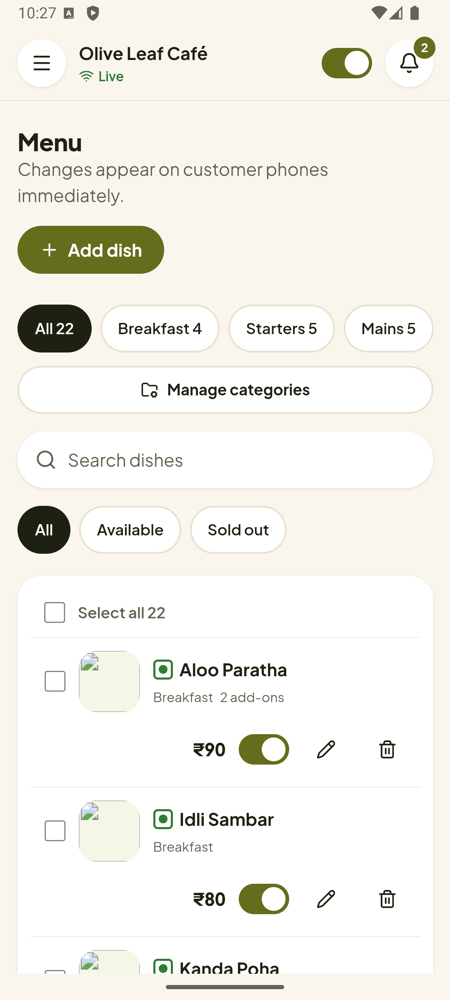
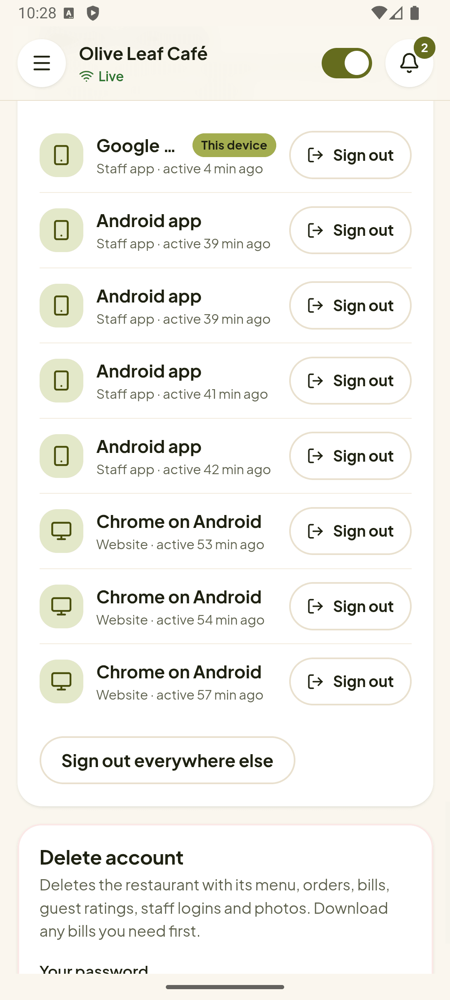

# QR Menu: guide for restaurant owners

This guide explains, step by step, how to run your restaurant with QR Menu. You do not need any technical
knowledge. Words in **bold** are the buttons and labels you see on screen.

## Contents

1. [How QR Menu works](#1-how-qr-menu-works)
2. [Create your account](#2-create-your-account)
3. [Set up your restaurant](#3-set-up-your-restaurant)
4. [Set up your menu](#4-set-up-your-menu)
5. [Tables and printing QR codes](#5-tables-and-printing-qr-codes)
6. [During service: the orders board](#6-during-service-the-orders-board)
7. [The kitchen screen](#7-the-kitchen-screen)
8. [Bills and payments](#8-bills-and-payments)
9. [Staff accounts](#9-staff-accounts)
10. [Analytics](#10-analytics)
11. [Guest feedback](#11-guest-feedback)
12. [What your guests see](#12-what-your-guests-see)
13. [The QR Menu Staff app](#13-the-qr-menu-staff-app)
14. [Tips and common questions](#14-tips-and-common-questions)

## 1. How QR Menu works

- Every table gets its own QR code.
- A guest scans it with their phone camera. Your menu opens in the browser: no app to download, no login.
- The guest picks dishes and taps **Place order**. The order appears on your screen at once, with the table
  number, so you always know where it goes.
- You and your kitchen move the order along (Preparing, Ready, Served). The guest sees each step on their phone.
- When they are done, you make the bill, take payment by cash, UPI or card, and the order is closed.

You can use QR Menu on a laptop, tablet or phone. Keep the dashboard open at the counter during service.

## 2. Create your account

1. Open the QR Menu website and tap **Start free** (or **Create account**).
2. Fill in your **Restaurant name**, **Email**, **Mobile number**, **Number of tables** and a password.
3. Tap **Create account**. You are taken to your dashboard.

Next time, use **Log in** with the same email and password. If you forget your password, tap
**Forgot password?** on the login page and enter the code sent to your email. (If it says email is not set
up, ask whoever runs your QR Menu website.)

> Want to look around first? Tap **Try live demo** on the home page to see a sample café as a guest.

## 3. Set up your restaurant

Open **Settings** in the menu on the left (on a phone, tap the ☰ button at the top left first).

**Restaurant profile**
- **Restaurant name**, **Tagline** (a short line under your name, e.g. "South Indian breakfasts since 1998")
  and **Address**.
- **Logo**: shown round on the menu. **Banner photo**: the big picture guests see first. See
  [adding photos](#adding-and-cropping-photos) below.

**Opening hours**
- Set the time you open and close for each day, or mark a day closed. **Copy Monday to every day** saves time.
- Guests see whether you are open now.

**Billing and tax**
- **GSTIN**: your GST number. With it, bills are titled "Tax Invoice"; without it, just "Bill".
- **GST rate**: for most restaurants 5%. It is added to every order and split into CGST and SGST on the bill.
- **Service charge %**: optional; leave at 0 if you do not charge one.
- **UPI ID** (e.g. `yourname@okhdfcbank`): bills then show a QR code that guests scan with any UPI app to pay
  the exact amount.

Tap **Save** at the bottom of each section.

**Alerts on this device** (set these on each device you use at the counter)
- **Sound for new orders and table requests**: use **Play test sound** to check the volume.
- **Read new orders aloud**: the device speaks the table number of each new order.
- **Browser notifications when this tab is hidden**: a pop-up even when you are in another tab or app.

## 4. Set up your menu

Open **Menu**. Changes appear on guests' phones immediately, even on menus that are already open.

### Categories

Categories are the sections of your menu (Breakfast, Starters, Mains, Beverages...). Use
**Manage categories** to add, rename or reorder them; the order here is the order guests see.

### Adding a dish

1. Tap **Add dish**.
2. Fill in:
   - **Name** and **Price (₹)**. The price is before GST.
   - **Category**.
   - **Description** (optional): ingredients, taste, portion.
   - **Photo**: a good photo sells the dish.
   - **Veg or non-veg**: shows the green or red mark.
   - **Badges** (optional, up to 3), e.g. **Bestseller** or "Chef's special".
   - **Spice level** and **Calories** (optional).
3. **Sizes** (optional): for dishes sold in more than one size, e.g. Half ₹180 and Full ₹290. The guest must
   pick one.
4. **Add-ons** (optional): extras with a price, e.g. "Extra cheese ₹30". The guest can pick any number.
5. **Hindi and Marathi** (optional): the dish name and description in Hindi and Marathi. If you fill these in,
   guests get a language switch on the menu. Have a native speaker check the spelling.
6. Tap **Add dish**. To change a dish later, tap its pencil (Edit) button and then **Save changes**.

### Adding and cropping photos

Every photo field gives you several ways to add a picture:
- **Upload** a photo from your phone or computer (or drag it onto the box),
- copy a picture and press **Ctrl+V** on a computer, or
- paste a link to a picture on the internet and tap **Add**.

A crop screen then opens. Drag the photo to choose what shows, use **Zoom** and **Rotate**, and check the
**Preview** of how it will look on the menu. You can change the crop later with **Edit crop**.

Use only photos you took yourself or have permission to use.

### Sold out

- Turn a dish off with its switch in the menu list when you run out. Guests see "Sold out" straight away and
  cannot order it. Turn it back on when it is available again.
- To change many dishes at once, tick them (or **Select all**) and choose **Mark sold out** or
  **Mark available**.

## 5. Tables and printing QR codes

Open **Tables & QR**.

- **Add table** adds the next table number. Remove a table with its bin button (its printed QR code then stops
  working).
- **QR style**: pick a **Colour** that suits your restaurant and a **Centre logo** (your logo in the middle of
  the code).
- **PNG** downloads the QR code for one table as a picture. **Download all (A4 PDF)** makes a printable sheet
  with four table cards per page.

**Before you print**
- Print QR codes only once your website address is final. The code contains the address you downloaded it
  from, so codes made on a test address stop working later.
- Scan each printed code with a phone to check it opens the right table.
- Laminate the cards or use table stands so they survive spills.

## 6. During service: the orders board

**Accepting orders**: the switch at the top of the dashboard. Turn it off to pause orders (for example when the
kitchen is full or you are closing). Guests can still look at the menu but cannot order.

Open **Orders**. The board has a column for each step:

| Column | What it means | What you do |
| --- | --- | --- |
| **New** | A guest just ordered | Check it and tap **Accept** |
| **Preparing** | The kitchen is cooking | Tap **Mark ready** when the food is ready |
| **Ready** | Waiting to be taken to the table | Tap **Mark served** once it is on the table |
| **Served** | The guest is eating | Tap **Bill** when they ask for the bill |
| **Billed** | Bill made, not paid yet | Take payment and tap **Mark paid** |

- You can also drag a card to another column.
- The arrow button moves an order back one step if you tapped by mistake; the ✕ button cancels an order.
- The printer button opens the receipt for that order, to print or check it at any time.
- New orders play a sound. Use the speaker button to mute it.
- Filter by **Table**, or open **History** to see earlier days.

**Table requests**: the bell at the top right shows guests who tapped **Call waiter**, asked for **Water**,
**Cutlery** or **Ask for bill**. Tap the bell to see them, and **Done** once handled.

The **Home** page gives a quick view of today: orders, revenue, average order, live orders, table requests and
today's top dishes. **Copy link** copies your menu link to share on WhatsApp or Instagram.

## 7. The kitchen screen

The kitchen screen shows only what the kitchen needs, in big text. Put it on a tablet or TV in the kitchen.

1. On the kitchen device, log in (use a **Kitchen** staff account, see [Staff accounts](#9-staff-accounts)).
   It opens the kitchen screen directly. From the dashboard you can also open **Kitchen display** in the menu.
2. Each order is a ticket with the table number, dishes, sizes, add-ons and the guest's notes. The timer shows
   how long ago it was ordered and changes colour after 10 minutes, and again after 20, so late orders stand out.
3. Tap **Start cooking** when you begin. Tap **Bump · Ready** when it is ready: the ticket leaves the screen and
   the waiter sees it as Ready.
4. Bumped by mistake? The recall button (↶) at the top brings the last ticket back.
5. Buttons at the top: show **New** or **Cooking** tickets only, mute the sound, keep the screen awake and full
   screen.

## 8. Bills and payments

1. On a served order, tap **Bill**. QR Menu gives the bill an invoice number (for example `2026-27/000001`,
   counting up through the financial year) and shows the receipt.
2. The receipt shows the dishes, subtotal, CGST and SGST, total and, if you set a **UPI ID**, a QR code to pay.
3. **Print** prints the receipt on your receipt printer (80 mm). **Make bill** downloads a full A4 invoice PDF
   with your GSTIN, place of supply and the amount in words: useful when a guest asks for a proper GST invoice.
4. Under **Take payment**, choose **Cash**, **UPI** or **Card** (you can note the UPI reference or card slip
   number) and tap **Mark paid**. The order is closed.

Waiters and managers can make bills too; the kitchen cannot.

## 9. Staff accounts

Give each person their own login instead of sharing yours. Open **Staff** (owners only) and tap **Add staff**.

| Role | Can use |
| --- | --- |
| **Owner** (you) | Everything, including staff and settings |
| **Manager** | Everything except staff accounts |
| **Waiter** | Orders board, bills and table requests |
| **Kitchen** | Kitchen screen only |

1. Enter the person's **Name**, **Email** and **Role**.
2. QR Menu creates a **Temporary password**. Use **Copy password** and give it to them in person or on WhatsApp.
3. They log in with their email and that password, then change it in **Settings** > **Change password**.

When someone leaves, turn their account off or remove it on the **Staff** page; they can no longer log in.

## 10. Analytics

Open **Analytics** (owner and manager) to see how the business is doing. Choose **Today**, 7, 30 or 90 days, or
your own dates.

- **Sales**, **Orders**, **Average order** and **Dishes sold**, compared with the period before.
- **Sales by day** (or by week for longer periods).
- **Top dishes**: what sells most, and what does not.
- **Sales by category**.
- **Busiest hours**: which days and hours are busiest, to plan staff.
- **Tables**: orders and sales per table, and how often each QR code was scanned.
- **Payments**: how much came in by cash, UPI and card.

Each chart has a table view if you prefer numbers. Cancelled orders are left out.

## 11. Guest feedback

After an order is served, the guest's phone asks "How was your meal?". They give 1 to 5 stars, can tap quick
tags (like "Tasty food" or "Slow service") and write a comment.

Open **Feedback** to see your **Average rating**, the share of **Happy guests**, what guests mention most, and
the latest comments. Filter to low ratings (**Needs attention**) to see what to improve.

## 12. What your guests see

1. **Welcome screen**: your banner, logo, name, table number and opening hours, and **View Menu**.
2. **Menu**: categories, search, filters (veg only, favourites, hide sold out), and the language switch if you
   added Hindi or Marathi names.
3. **Dish page**: photo, description, sizes, add-ons and a notes box ("less spicy", "no onion").
4. **Cart**: the order with GST, an optional name, and **Place order**.
5. **Order status**: Received, Preparing, Ready, Served, updated live. From here they can **Call waiter**,
   **Ask for bill** or **Reorder**, and rate the meal once it is served.

Guests can also add the menu to their home screen like an app.

## 13. The QR Menu Staff app

QR Menu Staff is the app for you and your staff on Android phones and tablets, iPhones and iPads. It has
everything from the dashboard on the website, and adds alerts that ring even when the phone is in a pocket. Your guests do not need
it: they keep ordering by scanning the table QR code.

  
  
  

### Installing the app

- **Android**: search for **QR Menu Staff** on Google Play and tap **Install**. (While the app is being tested
  you may get it as a file instead: open the file on the phone and allow the install when Android asks.)
- **iPhone and iPad** (iOS 15 or later): search for **QR Menu Staff** on the App Store and tap **Get**. While the
  app is being tested you get an email invitation to **TestFlight** instead: install Apple's TestFlight app,
  open the invitation on the iPhone and tap **Install**.
- Open it and sign in with the **same email and password** you use on the website. Staff use their own logins.
  New restaurants can tap **Create your restaurant** in the app.
- The app opens on the right screen for each person: the kitchen display for Kitchen staff, the orders board for
  waiters, and the dashboard home for owners and managers.

### Order alerts

The first time you sign in, the phone asks whether QR Menu Staff may send notifications: tap **Allow**.

| Alert | Who gets it | Sound |
| --- | --- | --- |
| New order | Owner, Manager, Kitchen | Three rising chimes |
| Waiter called, or water, cutlery or the bill asked for | Owner, Manager, Waiter | A two-note bell |
| Order ready to serve | Waiter | Two short high beeps |

- Alerts arrive when the app is closed and the phone is locked. Tap one to go straight to that order.
- To stop a kind of alert on one phone: **Settings > Notifications on this phone**, and turn that switch off.
- If alerts stopped completely: Android **Settings > Apps > QR Menu Staff > Notifications**, and turn them on.
  Some phones (Xiaomi, Oppo, Vivo, Realme) also need **Battery > No restrictions** for the app, or they hold back
  alerts to save battery.
- iPhone and iPad: new orders and table requests are **time-sensitive**, so they still come through when a Focus
  (Do Not Disturb, Sleep, Work) is on. If alerts stopped: iPhone **Settings > Notifications > QR Menu Staff**,
  turn on **Allow Notifications**, **Sounds** and **Time Sensitive Notifications**.

### The kitchen tablet

- Sign in on the kitchen tablet with a **Kitchen** login. The screen stays on while the kitchen display is open,
  so it does not go dark in the middle of service.
- Turn the tablet sideways for more tickets on screen. Tap the full-screen button to hide the status bar.
- An **iPad** works the same way, in either direction. On an **iPhone**, the kitchen display is the one screen
  that turns sideways; the rest of the app stays upright.
- Pull down from the top of the screen to refresh.

### Things the app does that the website cannot

- **Take photo** and **Choose from gallery** (on iPhone: **Choose from Photos**) when adding a dish photo or your
  logo.
- **PNG** and **Download all (A4 PDF)** on Tables & QR, and **Share PDF** on a bill, open the share menu: send
  them on WhatsApp, save them to Drive, or print them.
- **Print** on a bill prints through Android's printing (any printer set up on the phone, or "Save as PDF"), or
  on iPhone and iPad through **AirPrint** (any AirPrint printer, or Save to Files). Shared PDFs have a **Print**
  button in the share menu too, and on iPhone **Save Image** puts a QR code in your Photos.
- If the internet drops, a black bar says so; orders update by themselves when you are back online.
- When a new version is needed, the app asks you to update. Tap **Update** to go to the Play Store (on iPhone,
  the App Store).

### On iPhone and iPad

- iPhones have no back button: **swipe in from the left edge** of the screen to go back, as in Safari. Every
  window and panel has a **×** (Close) button at the top.
- The screen moves up when the keyboard opens, so the box you are typing in stays in view.
- To log out: open the menu (☰) and tap **Log out**.

### Signed-in devices and signing out

**Settings > Signed-in devices** lists every browser and phone signed in to your login, with when it was last
used.

- **Sign out** next to a device signs it out at once. Use it for a lost phone or a staff member's old phone.
- **Sign out everywhere else** signs out every other browser and phone; the one you are using stays signed in.
- Changing your password also signs out all your other devices.
- To sign out of the app: open the menu (☰) and tap **Log out** (on the kitchen display: the exit button at the
  top left). Signing out stops that phone's alerts.

### Deleting your account

**Settings > Delete account**, in the app or on the website, asks for your password (owners also type
**DELETE**), then deletes:

- for an owner, the whole restaurant: menu, photos, orders and bills, guest ratings, staff logins and devices.
  This cannot be undone, so download any bills you need first.
- for a staff member, only their own login.

The same is possible on the website at **/delete-account**.

## 14. Tips and common questions

**The internet goes down.** Guests see a page saying they are offline, and the menu comes back by itself when the
connection returns. Keep your counter device on a stable connection; a mobile hotspot is a good backup.

**Can I change prices or mark dishes sold out during service?** Yes. Guests see the change immediately.

**A guest cannot scan the code.** Most phone cameras scan QR codes directly; on older phones, use Google Lens
or a QR app. You can also share your menu link from **Home** > **Copy link**.

**A guest ordered for the wrong table.** Cancel the order (✕ on the card) and ask them to scan the code on their
own table.

**Can guests pay online?** Guests pay at the counter or the table: cash, card, or UPI using the QR code on the
bill. Online payment inside the menu is planned.

**Where do I find old orders?** **Orders** > **History**, and pick a date.

**Can I use QR Menu on my phone?** Yes: install the **QR Menu Staff** app on Android (see chapter 13), or open
the website, log in, and choose "Install app" or "Add to Home screen" in your browser menu.

**I forgot my password.** Tap **Forgot password?** on the login page. Staff can ask the owner, who can remove
and re-add them with a new temporary password.
